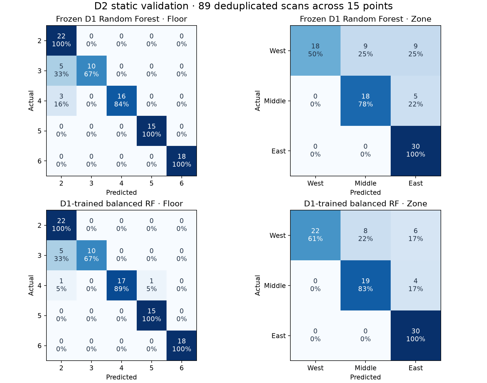

# T8 FloorSense 五层 D2 验证与实时接入

2026-11-10 · Wi-Fi-only · C 岗位

## 结论

本报告采用 **2–6F 连续五层**口径。优化随机森林在 D2 的四朝向汇总中识别对了 **14/15 个点位（93.33%）**，单扫描楼层、Zone、联合准确率分别为 **92.13%、79.78%、78.65%**。D2 用于开发选型。五层 D3 计划以全部 74 个独立点作真机盲测，90% 目标对应至少 **67/74** 个点正确。

唯一的点位级楼层错分是 `T8-F3-B-VA01`。先原位复测并做邻点对照，再根据原因决定是否增加 Train 点。实时接入仍使用优化随机森林，新增两个更新条件：至少 15 个模型已知 AP、楼层投票分数至少 0.50。原分类器权重沿用 D1 拟合结果。

## 数据与评分口径

- 静态 15 个 VA 点、每层 3 点、每点四个朝向，共 60 Session。按规划和 VA 编号把原始 `split=train` 重新解释为 `validation`，60 条逐 Session 对照见 `baseline/static_validation_manifest.csv`。原始 ZIP 保持原样。
- 303 次扫描中排除 2 次明确未更新且复用前一点结果的扫描。301 次合格扫描中，按 Point ID 去重后保留 89 条；按 Session 去重后保留 91 条。D1 和 D2 的 Point ID、Session ID、去重指纹均无交集。训练、BSSID 词表和样本权重只来自 D1 50 点、271 条去重扫描。
- 单次扫描准确率用 89 条点内去重指纹，接近 D 实时一次扫描的输入。点位准确率用每个 Session 内去重后的模型类别分数先平均，再对四个朝向等权平均取最大类；每点只计一次。汇总可改善部分错误，但手机单次扫描无法获得四个朝向的结果。60 个 Session 的单方向汇总另存 CSV。
- 楼层模型固定用 2–6F 类别。楼层与 Zone 独立使用 BSSID/RSSI；楼层+Zone 联合要求两项都正确。后文的门限回放另报覆盖率，分类器的原始成绩保留作为对照。
- D2 实际采集记录为同一采集人和同一款 vivo V2068A。各 VA 点与同锚区 TR01 共享地标文字，现场坐标仍空；数据可核实编号独立，实际站位与间距应由采集组补填。完整质量核对见 `static_quality_audit.md`。

## 冻结基线和候选对比

| 模型 | 楼层 / 89 扫描 | Zone / 89 扫描 | 联合 / 89 扫描 | 楼层 / 15 点 | Zone / 15 点 | 联合 / 15 点 |
| --- | ---: | ---: | ---: | ---: | ---: | ---: |
| 冻结 D1 KNN | 78 · 87.64% | 55 · 61.80% | 53 · 59.55% | 14 · 93.33% | 10 · 66.67% | 10 · 66.67% |
| 冻结 D1 随机森林 | 81 · 91.01% | 66 · 74.16% | 64 · 71.91% | 14 · 93.33% | 11 · 73.33% | 11 · 73.33% |
| 优化随机森林 | 82 · 92.13% | 71 · 79.78% | 70 · 78.65% | 14 · 93.33% | 11 · 73.33% | 11 · 73.33% |
| 优化逻辑回归 | 82 · 92.13% | 65 · 73.03% | 64 · 71.91% | 14 · 93.33% | 14 · 93.33% | 14 · 93.33% |

两种候选把词表从 1,226 个缩至 934 个 BSSID，保留至少两个 D1 点见过的 BSSID；训练按同类点位等权、类别等总权重处理 West 训练点偏少。随机森林限制每叶至少 2 条扫描，逻辑回归使用 L2 正则化。设置与训练接口见 `CANDIDATES.md`。实时候选按扫描楼层、联合正确率顺序选择；静态对照按点位楼层、联合正确率顺序选择。**候选都由 D2 选型，提升需在 D3 复核。**

| 真实楼层 | 冻结 D1 RF 单扫描 | 优化 RF 单扫描 | 冻结 D1 RF 点位 | 优化 RF 点位 |
| --- | ---: | ---: | ---: | ---: |
| 2F | 22/22 · 100% | 22/22 · 100% | 3/3 | 3/3 |
| 3F | 10/15 · 66.67% | 10/15 · 66.67% | 2/3 | 2/3 |
| 4F | 16/19 · 84.21% | 17/19 · 89.47% | 3/3 | 3/3 |
| 5F | 15/15 · 100% | 15/15 · 100% | 3/3 | 3/3 |
| 6F | 18/18 · 100% | 18/18 · 100% | 3/3 | 3/3 |

冻结 D1 随机森林，15 点楼层混淆矩阵。行是实际值，列是预测值。

| 实际 \ 预测 | 2F | 3F | 4F | 5F | 6F |
| --- | ---: | ---: | ---: | ---: | ---: |
| 2F | 3 | 0 | 0 | 0 | 0 |
| 3F | 1 | 2 | 0 | 0 | 0 |
| 4F | 0 | 0 | 3 | 0 | 0 |
| 5F | 0 | 0 | 0 | 3 | 0 |
| 6F | 0 | 0 | 0 | 0 | 3 |

冻结 D1 RF 的点位 Zone 混淆矩阵如下。优化 RF 点位结果完全相同；逻辑回归点位只剩 1 个 West→East。

| 实际 \ 预测 | West | Middle | East |
| --- | ---: | ---: | ---: |
| West | 2 | 2 | 1 |
| Middle | 0 | 4 | 1 |
| East | 0 | 0 | 5 |

## West 与具体错分

冻结 D1 RF 的 West 扫描有 18/36 正确，9/36 判成 Middle、9/36 判成 East。优化 RF 提升至 22/36，仍有 8/36 判成 Middle、6/36 判成 East。优化逻辑回归四朝向合并时 West 为 4/5，单扫描只有 16/36；不能用四朝向结果代替实时表现。

| 验证位置 | 冻结 D1 RF 与优化 RF 的点位预测 | 现场优先复核 |
| --- | --- | --- |
| `T8-F3-B-VA01`，3F West | 2F / East | T8-302/307 外。5 条去重扫描均判成 2F/East，仅 1–13 个 AP；同期其他 14 点每条至少 16 个 AP。重访确认是局部弱覆盖还是采集异常，保留原成绩。 |
| `T8-F4-B-VA01`，4F West | 4F / Middle | T8-408/407 外。优化 RF 仍有一条北向扫描误判 2F。需要 Zone 加分时再做 B/C 边界对照。 |
| `T8-F6-B-VA01`，6F West | 6F / Middle | T8-610/609 外。冻结 RF 的 7 个指纹中 5 个 Zone 判 Middle，楼层全对。 |
| `T8-F2-E-VA01`，2F Middle | 2F / East | T8-202 外侧走廊。E 属于 Middle，核实现场 E/F 边界的标注。 |

冻结 D1 RF 的 8 条楼层错分都指向 2F。优化 RF 的 7 条错分中 6 条指向 2F，另有 `T8-F4-G-VA01` 的一条扫描判成 5F。3F 的另外两个验证点共 10 条扫描全部正确。仅作敏感性分析，移除 B-VA01 的 5 条扫描后，冻结 D1 RF 为 **81/84（96.43%）**，优化 RF 为 **82/84（97.62%）**。原始主表继续保留该点。

## 3F B-VA01 原位复测

**首轮新增 Train 点数为 0。** 在平面图上标出原位和同层邻点；同手机、同一时段先对比两处，再重复四朝向、另一时段和另一型号手机。每条记录保留总 AP 数、已知 AP 数、实际扫描时间、`fresh`、`results_updated`、AP age 和设备。B-VA01 复测继续标 Validation。

原位 5 条去重指纹的总 AP 数为 **1、6、11、12、13**，其余 14 个点的每条去重扫描总 AP 数至少 16。该点四个 Session 的 20 次原始回调均标记已更新，采集器的 `wifi_throttled` 均为 `false`。现有日志支持「该位置观测稀疏」，尚无法归因为系统节流或证明长期死点。若复测显示采集异常，先修采集链路；若多机多时段仍稀疏，保留该验证点并用质量门限及到达后的重扫处理。只有在邻近、信号可用的位置反复出现错分后，再考虑追加独立 Train 点。

## 实时质量门限与回放

`D_handoff/realtime/wifi_model.json.gz` 的 `realtime_policy` 要求 **已知 AP ≥15 且楼层投票分数 ≥0.50** 才接受新估计。低于任一门限时保留当前会话上次接受的楼层并标记 `held`；冷启动标记 `waiting`，不填默认楼层。原始投票分数未做概率校准，保持中的楼层也可能已经过时。

静态回放将 89 条扫描分别作为一次冷启动，隔离门限本身的影响。

| 更新规则 | 可更新扫描 / 全部 | 正确楼层 / 更新扫描 | 正确更新 / 全部 | 有可更新扫描的点位 |
| --- | ---: | ---: | ---: | ---: |
| 无门限 | 89/89 | 82/89 · 92.13% | 82/89 · 92.13% | 15/15 |
| 已知 AP ≥15 | 84/89 · 94.38% | 82/84 · 97.62% | 82/89 · 92.13% | 14/15 |
| **已知 AP ≥15 且楼层投票 ≥0.50** | **80/89 · 89.89%** | **80/80** | **80/89 · 89.89%** | **14/15** |

双门限挡住了 7 条错分，也挡住 2 条原本正确的扫描。无历史状态的 B-VA01 等待新信号；主报告保留完整分母。双门限用 D2 选定，等待 D3 再评价真机上的错跳、等待时间和覆盖率。

6 条动态 Run 从各自冷启动按时间顺序回放。5F→6F 的 `T8-ST04-VA01` 有 **31/31** 次原始结果为 2F，总 AP 中位数 **8**，已知 AP 中位数 **5**；作为对照，2F 水平走廊总 AP 中位数 **72.5**。只设 AP 门限时，仍有 2 次分别观测到 16 个已知 AP 的扫描更新为 2F，两条投票分数均约 0.436。双门限阻止这两次更新，整段 **0 次误跳、0 次确认到 6F**。如果运行前已经确认 5F，界面会维持 5F 并显示待更新，直到有足够证据。6F→4F 的电梯 Run 也没有在到达后确认 4F。门限适合抑制弱信号错跳，跨层到达仍需联合 E 验证并在到达后获取新扫描。两条水平 Run 分别接受 48 条 2F 和 44 条 4F 的正确扫描。

逐条回放、汇总和状态输出见 `realtime_replay/`。动态移动途中没有逐扫描真实楼层标签，回放按 `move_start` / `move_end` 区分阶段，仅用起终点分析到达后的更新情况。

## 项目达标与 D 的接入

五层主评使用 2–6F 的 **74 个 D3 TS 点**，目标 **≥67/74**。课程原文另写明基础项须在选定的三个连续楼层上覆盖至少 50 个不同位置，并在手机上实时展示。D3 采集时保留规划中基础楼层的 54 个点及逐点输出，供老师核验基础项；五层结果和加分证据用完整 74 点评估。93.33% 是开发阶段五层汇总成绩，五层加分等待真机与 D3 证据。

D3 前固定模型、门限、每点等待窗口与评分规则。记录每点新估计、等待时间及是否无有效更新。保持的历史楼层和超时无新估计单独标记，并保留在全点位分母中，避免仅对成功更新的位置计算正式准确率。

`D_handoff/realtime/` 提供优化 RF 的 `selected.joblib`、BSSID 特征配置、带门限的 gzip JSON、Python 参考和状态测试向量。D 的 App 或后端需调用 `realtime_step` 或移植同一规则。JSON 与 Python 参考已离线回放，仍需在 App 和手机上实测。`D_handoff/static_comparison/` 保留四朝向逻辑回归对照。

动态验证的 6 条 VA Run 均按 Validation 单列，未参与 C 的训练或静态评分。ST08 的两个小平台已在 sidecar 中标成 `stair_landing`，不算实际经过楼层；ST04 的一个提前终点标记另列待核对。详见 `动态数据交接.md`。

## Advanced Feature 5 · Temporal Robustness

11 月 11 日对 2–6F 的 20 个既有 Train 位置做 N 朝向复测。冻结 V1 的 Floor 和 Zone 均为 20/20，100 次回调全部通过更新门限，去重后保留 26 条。V2 加入这 26 条后，在原 15 个 Validation 点上的楼层准确率维持 14/15，联合正确数从 11/15 升到 12/15，West 实时正确数从 22/36 降到 21/36，因此保留 V1 接入。跨日配对数据、信号变化图和 10 锚点有限校准方案见 [Advanced Feature 5](../temporal_robustness/Advanced_Feature_5.md)。
