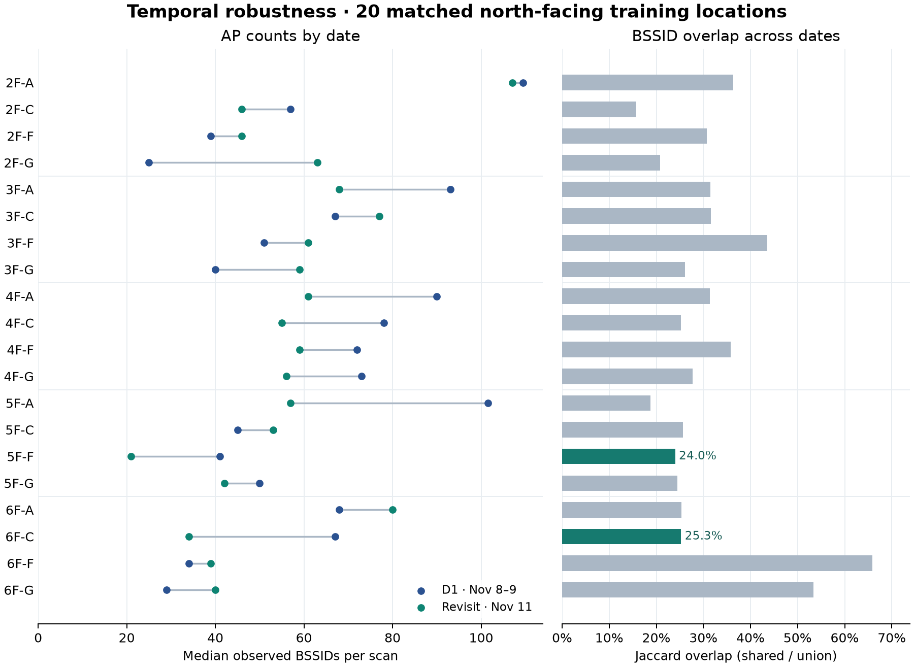

# Advanced Feature 5 · Temporal Robustness

T8 FloorSense · 2026-11-11 · 2–6F

**保留 Model V1 用于实时接入。** 11 月 11 日复测验证了 V1 在 20 个既有训练位置上的跨日表现。把复测样本加入训练后，V2 在独立于训练的 15 个 Validation 点上多识别对一个点的 Zone，但 West 实时扫描少识别对一条。V2 保留为实验候选。

## 冻结 V1 的跨日回放

V1 是接入包里的 D1 优化随机森林，使用 934 个 BSSID 的词表。实时楼层更新要求至少 15 个已知 AP、楼层投票分数至少 0.50。先保存冻结模型哈希和回放明细，再训练 V2。

20 个锚点覆盖 2–6F，每层 A/C/F/G 的原 `TR01` 各 1 个。两期均使用 N 朝向，设备型号记录为 vivo V2068A。11 月 11 日有 100 条合格扫描，17 个 Session 的 5 条扫描完全相同。同点精确去重后保留 26 条无线指纹。重复率衡量样本冗余，采集日志仍记录这些回调为已更新。

| 冻结 V1 回放 | 门限通过 | Floor 正确 | Zone 正确 | Floor + Zone 同时正确 |
| --- | ---: | ---: | ---: | ---: |
| D1 匹配 N 朝向去重扫描（训练数据参考） | 37/37 | 37/37 | 37/37 | 37/37 |
| 11 月 11 日复测原始扫描 | 100/100 | 100/100 | 100/100 | 100/100 |
| 11 月 11 日复测去重扫描 | 26/26 | 26/26 | 26/26 | 26/26 |
| 11 月 11 日复测点位 | 20/20 有有效更新 | 20/20 | 20/20 | 20/20 |

点位以通过门限的去重扫描投票。本批扫描最低已知 AP 数为 21，最低楼层投票分数为 0.694。20 个点均曾参与 V1 训练，因此这是**已见位置跨日复测**。未来日期未见位置的表现由后续盲测评价。

## 同点同朝向的 Wi-Fi 变化

先按点和日期去重，再计算每点扫描 AP 数中位数。BSSID 重合用当日该点所有保留扫描的 BSSID 并集计算 Jaccard（两期交集 ÷ 两期并集）。RSSI 对每个共有 BSSID 分别取两期观测中位数，再计算变化量。

跨 20 点，单次扫描 AP 数的点位中位数由 **62 降到 56.5**，同点 Jaccard 中位数为 **26.93%**。共有 BSSID 的点位 RSSI 变化中位数为 **0 dB**，绝对变化的点位中位数为 **3.5 dB**。AP 并集和重合度会受到两期有效去重扫描数量（37 与 26）的影响。

| 复测位置 | 每扫描 AP 数中位数 D1 → 复测 | 两期共有 / 合并 BSSID | Jaccard | 共有 BSSID 绝对 RSSI 变化中位数 |
| --- | ---: | ---: | ---: | ---: |
| 5F-F | 41 → 21 | 12/50 | 24.0% | 2.0 dB |
| 6F-C | 67 → 34 | 24/95 | 25.3% | 4.5 dB |
| 5F-A | 101.5 → 57 | 31/165 | 18.8% | 4.0 dB |
| 2F-G | 25 → 63 | 25/120 | 20.8% | 3.0 dB |

2–5F 从 11 月 8 日晚间换到 11 月 11 日上午。6F 从 11 月 9 日上午换到 11 月 11 日晚间，并由 P2 换成 p1。20 对记录的手机型号一致，16 对采集者一致。差异反映日期、时段和现场采集条件共同变化，无法单独归因于日期或手机。配对明细见 [paired_drift.csv](paired_drift.csv)。

## V2 跨时间训练增强

V2 只把 11 月 11 日通过质量检查的 **26 条新指纹**加入 D1 的 271 条，合计 **297 条、50 个训练位置**。保留 V1 的随机森林超参数、点位和类别权重、AP 出现点数规则及实时门限。词表随训练数据从 934 项更新至 949 项。11 月 10 日的 15 个独立 Validation 点及其 89 条去重扫描对两个版本完全相同，点位、Session 和完整训练指纹均无交集。

| 2–6F Validation 指标 | V1 | V2 |
| --- | ---: | ---: |
| 四朝向汇总 Floor | 14/15（93.33%） | 14/15（93.33%） |
| 四朝向汇总 Zone / 联合 | 11/15（73.33%） | 12/15（80.00%） |
| 四朝向汇总 West Zone | 2/5 | 3/5 |
| 单扫描原始 Floor / Zone / 联合 | 82 / 71 / 70（均以 89 为分母） | 82 / 71 / 70（均以 89 为分母） |
| 实时门限通过 | 80/89（89.89%） | 81/89（91.01%） |
| 实时 Floor 正确更新 | 80/89 | 81/89 |
| 实时联合正确更新 | 68/89 | 69/89 |
| 实时 West Zone 正确更新 | 22/36（61.11%） | 21/36（58.33%） |

V2 修正 `4F-B-VA01` 的点位 Zone，并使 `4F-G-VA01` 的一条正确扫描通过门限。`6F-B-VA01` 有一条原先正确的 West 扫描改判 Middle。两版 `3F-B-VA01` 的点位楼层仍判成 2F，实时门限均不接受该点的新估计。按实验前确定的规则，V2 的 West 实时指标下降，因此接入版继续用 V1。V2 权重和配置保存在 `results/v2_candidate/`，供后续实验使用。

## D3 前的复测和有限校准

1. **先原位复测 3F B-VA01。** 这批复测覆盖 A/C/F/G，没有采到 B。用同一手机同时段对照 B-VA01 与邻点，再换时段或手机。复测仍归 Validation。若信号可用的邻近站位反复出现 West 错分，再规划不同物理位置的 Train 点。当前无需因此新增整批 West 训练点。
2. **预先固定 10 个校准锚点。** 建议每层从既有 Train 点取 A、G 各一个。正式实验在一个后续日期采同样的 N 朝向，每点固定采集窗口和回调预算，保存去重后实际参与校准的指纹数和耗时。以冻结 V1 为对照，校准版仅追加这 10 个锚点当天的合格指纹，使用相同随机森林、权重和更新门限重新拟合。
3. **在新日期的独立 TS 点做同输入配对比较。** 两个版本重放同一批原始扫描，使用事先固定的每点等待窗口与起始状态。主评采用规划的 74 个五层点，90% 对应至少 67 个正确位置，保留课程基础项所需的逐点记录。报告 Floor、Zone、West、覆盖率、超时、首次正确更新延迟，以及校准点数和耗时。历史楼层保持及超时无更新仍留在全点位分母。
4. **先冻结再看 TS 结果。** 固定 Train/Validation/Test 点的实际平面图位置、模型、词表、门限和实验窗口。增加另一个日期的配对结果可检验提升能否复现。11 月 11 日的同点复测与本次增强属于 Advanced Feature 5 的阶段证据，完整的有限校准效果等待这一步。

## 可直接放入英文报告的段落

We evaluated temporal robustness on 20 north-facing revisits to existing training locations across floors 2–6. The frozen D1 model correctly identified both floor and zone at all 20 locations and accepted all 100 scan callbacks. Exact deduplication left 26 fingerprints. Median per-scan AP count across locations decreased from 62 to 56.5, and median BSSID Jaccard overlap was 0.269. Adding the 26 revisit fingerprints to training improved joint point-level accuracy on the separate 15-location validation set from 11/15 to 12/15. Floor accuracy stayed at 14/15, while real-time West zone accuracy dropped from 22/36 to 21/36, so we retained V1 for app integration. These revisits measure cross-date repeatability at seen locations. A subsequent limited-calibration experiment will use ten fixed training anchors and evaluate both models on the same independent test positions.

## 10 锚点流程试跑

11 月 11 日的每层 A/G 锚点提供 12 条新去重指纹。冻结 V1 与有限校准版在同日留出的 10 个 C/F 复测位置上均为楼层与 Zone 联合 **10/10**，首次正确楼层延迟中位数均为 **1.126 秒**。C/F 是 D1 已见位置，此结果用于核对流程。新日期 10+74 的采集表和配对评分脚本已准备在 [D3 准备包说明](../d3_ready/README.md)。
