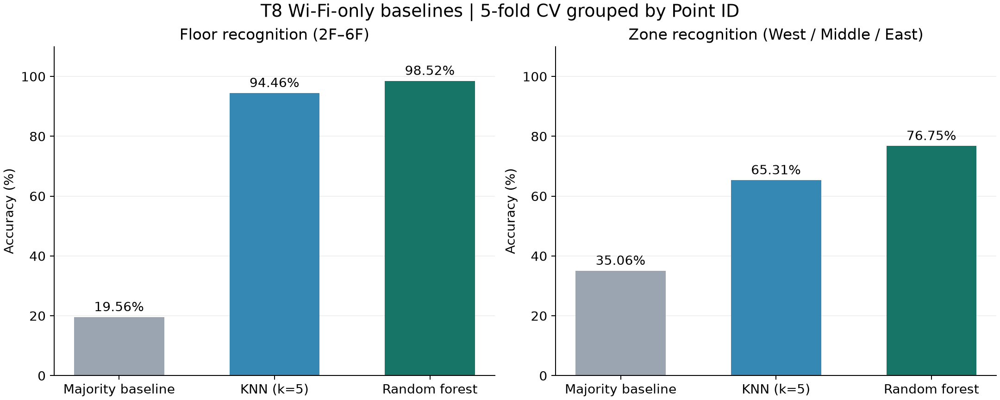
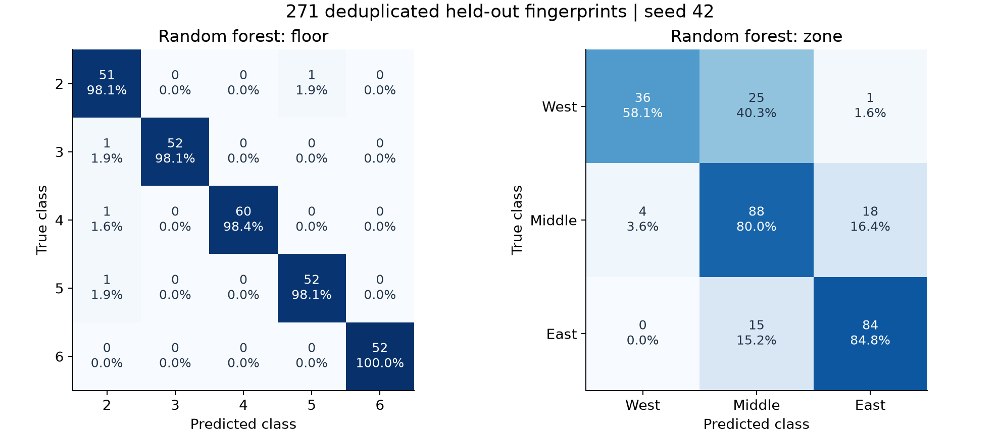

# T8 Wi-Fi 楼层与 Zone 识别：C 岗位基线实验报告

实验日期：2026-11-09。数据来源：用户提供的“数据.zip”中的 static_train.zip 与 T8_FloorSense_Integrated_Sampling_v2.xlsx。动态数据不参与本次 Wi-Fi-only 基线。

## 1. 结论

五层楼识别在现有训练数据的未见点位交叉验证中可行：随机森林主实验正确 267/271，楼层准确率 **98.52%**；KNN 正确 256/271，准确率 **94.46%**。三区定位较弱：随机森林为 **76.75%**，KNN 为 **65.31%**。建议把随机森林作为下一步独立验证候选，同时保留 KNN 作为易移植的参考基线。

这些数值是按 Point ID 分组的训练集内部交叉验证结果，**不是独立 Validation/Test、跨时间或跨设备测试准确率**。目前不能据此宣称正式测试已达到 90%，也不能保证手机现场表现。

## 2. 数据覆盖与质量

- 2–6 楼共 50 个 Train 点，每层 10 个；200 个 Session，每点 N/E/S/W 四个朝向齐全。
- 原始 Wi-Fi 共 54,028 行 AP 记录、1,016 次扫描。剔除 fresh=0 或 results_updated=0 的 13 次后剩 1,003 次。
- 同一点位内，按最终输入特征去除 732 次完全重复指纹，保留 **271 条**，重复比例为 **72.98%**。不同点位间相同指纹为 0，所有点仍有数据。
- 200 个 Session 中 152 个的原始扫描只有一种完整指纹。重复意味着新增信息有限；不能仅凭 BSSID/RSSI 完全一致证明设备一定返回了缓存。
- 4 次扫描存在重复 BSSID，共 16 条额外记录；均位于 T8-F6-A-TR01 的一个 Session。采用相同 BSSID 的 RSSI 中位数聚合，避免任意覆盖。
- 共见 1,226 个 BSSID（含同物理设备不同 SSID 对应的虚拟 BSSID，不能当作 1,226 台物理 AP）。缺失 BSSID 统一填 -100 dBm。
- T8-F2-F-TR02 的两个 Session 共 8 次 fresh 扫描仅 1–5 个 BSSID，优先复测。主实验保留低 AP 样本，不靠删除困难样本抬高成绩。
- 数据全部来自 P2、vivo V2068A、hand_flat。2–5F 全部在 2026-11-08 晚间采集，6F 全部在 2026-11-09 上午采集，楼层与日期/时段混杂。
- 规划表的现场具体位置和距离字段为空；目前以 Point ID 代理物理位置。应补上坐标、现场描述或照片，确认不同 ID 确实代表不同物理位置；本次不能审计这种物理空间隔离。

Zone 严格按规划表 Point Register 的粗 Zone 字段映射：**West=A/B；Middle=C/D/E；East=F/G/H**。其中 E 尽管位置描述为走廊东段，规划粗 Zone 仍是 Middle。每层 West 只有 2 个训练点，Middle 和 East 各 4 个。

## 3. 实验方法与防泄漏

- 输入仅 Wi-Fi BSSID → RSSI，不使用 Point ID、楼层、Zone、朝向、时间、SSID、设备信息、BLE 或传感器作为特征。
- fresh=1 且 results_updated=1；有效 RSSI 范围 [-127,0)，裁剪至 [-100,-20] dBm；AP age_ms 允许 [0,10000]。本数据该年龄阈值未剔除 fresh AP，未发现非法 RSSI 或清洗后空扫描。
- 每点去除相同特征指纹。相同点位的所有朝向归同一折。若未来出现跨点位相同指纹，代码将相关点合并为不可拆分组。
- 在唯一 Point ID 表上按楼层分层做 5 折，seed=42 为预先指定主实验；每折训练 40 点、验证 10 点，验证每层 2 点。每个主实验样本只被预测一次。
- AP 词表仅由该折训练数据建立，验证独有 AP 忽略；缺失 AP=-100。主实验每折 1,111–1,194 个特征；验证指纹中未知 AP 比例的折内均值约 1.82%–5.11%。全量 1,226 特征只用于最后重拟合的模型。
- KNN：k=5、欧氏距离、距离加权。随机森林：300 棵树、max_features=sqrt、min_samples_leaf=1、class_weight=balanced_subsample、random_state=42。楼层与 Zone 分别训练分类器。
- 参数固定，不用验证折搜索超参数。另用 seed=43–46 重复分组划分，展示结果对切分的敏感性；没有挑最高准确率作为主结果。
- 每折实际检查点位和指纹交集均为 0。5 折按楼层分层，但每折不保证覆盖全部 15 种楼层×Zone 组合；West 点位较少限制了更细分层。

分组和预处理原则参照 [scikit-learn 交叉验证文档](https://scikit-learn.org/stable/modules/cross_validation.html)；代码保存每点分折、每折诊断和逐条预测供复核。

## 4. 主结果：去重指纹，5 折，seed=42

| 模型 | 楼层准确率 | 楼层 Macro F1 | Zone 准确率 | Zone Macro F1 | 楼层和 Zone 同时正确 |
| --- | --- | --- | --- | --- | --- |
| Dummy | 19.56% | 0.0946 | 35.06% | 0.2088 | 8.12% |
| KNN | 94.46% | 0.9459 | 65.31% | 0.5883 | 64.21% |
| RandomForest | 98.52% | 0.9851 | 76.75% | 0.7590 | 75.65% |

这里准确率的分母为 271 条去重扫描；Macro F1 对固定五楼层/三区类别等权计算；单折缺失类别的 F1 置 0，主汇总覆盖全部类别。Dummy 在每折仅预测训练样本中最常见类别，作为无 Wi-Fi 学习的对照。

点位独立于扫描条数的补充口径：先计算每点扫描准确率，再对 50 个点等权平均。它不是“50 点各投票一次”的准确率。

| 模型 | 点位等权楼层准确率 | 点位等权 Zone 准确率 |
| --- | --- | --- |
| KNN | 95.29% | 66.56% |
| RandomForest | 98.83% | 76.19% |

固定主折预测上的点位簇 bootstrap（10,000 次）给出随机森林点位等权楼层描述性 95% 区间约 97.59%–99.78%，Zone 约 66.63%–84.73%。此区间未重训模型，不覆盖未来日期/设备变化，也不是正式独立测试置信保证。

## 5. 不同分组划分的稳定性

| 模型 | 楼层均值 ± SD | 楼层范围 | Zone 均值 ± SD | Zone 范围 |
| --- | --- | --- | --- | --- |
| KNN | 94.46% ± 0.58 个百分点 | 93.73%–95.20% | 65.54% ± 1.44 个百分点 | 64.21%–67.90% |
| RandomForest | 98.45% ± 0.61 个百分点 | 97.42%–98.89% | 73.58% ± 2.89 个百分点 | 69.00%–76.75% |

SD 是五次完整 5 折评估的准确率之间的标准差，不是独立样本标准误。五次反复使用同一批点位，不可声称样本量扩大五倍。随机森林 Zone 主折结果处于这五次结果上端，应同时报告平均 **73.58%** 与范围 **69.00%–76.75%**。

未去重诊断（仍按相同 Point 分组）得到 KNN 楼层 97.01%、随机森林 99.30%；其验证分母是 1,003 次高度相关扫描。它与主实验同时改变训练样本权重和验证样本权重，不能简单解释成“缓存导致准确率提升多少”，也不作为主要性能结论。

## 6. 混淆矩阵与薄弱点

矩阵行为真实类别、列为预测类别；每格第一行为数量、第二行为该真实类别的比例。

| 真实楼层 | 去重扫描数 | 楼层预测正确数 | 楼层准确率 | 本层 Zone 准确率 |
| --- | --- | --- | --- | --- |
| 2F | 52 | 51 | 98.08% | 59.62% |
| 3F | 53 | 52 | 98.11% | 79.25% |
| 4F | 61 | 60 | 98.36% | 86.89% |
| 5F | 53 | 52 | 98.11% | 77.36% |
| 6F | 52 | 52 | 100.00% | 78.85% |

随机森林主实验的 4 条楼层错误如下，均保留在评估分母内：

| 点位 | 朝向 | 真实楼层 | 预测楼层 | 检测到的 BSSID 数 |
| --- | --- | --- | --- | --- |
| T8-F3-D-TR01 | W | 3 | 2 | 43 |
| T8-F2-F-TR02 | W | 2 | 5 | 4 |
| T8-F4-A-TR01 | S | 4 | 2 | 65 |
| T8-F5-H-TR01 | N | 5 | 2 | 75 |

Zone 召回率表明 West 最弱，62 条 West 指纹中有 25 条被识别为 Middle：

| 真实 Zone | 正确/总数 | 召回率 |
| --- | --- | --- |
| West | 36/62 | 58.06% |
| Middle | 88/110 | 80.00% |
| East | 84/99 | 84.85% |

以下为随机森林主实验 Zone 准确率最低的 10 个点位（单次划分诊断，不代表所有未来场景的固定排序）：

| 点位 | 真实 Zone | Zone 正确/总数 | 预测出现的 Zone | 规划位置 |
| --- | --- | --- | --- | --- |
| T8-F2-B-TR01 | West | 0/4 | Middle | T8-201 外侧走廊 |
| T8-F2-F-TR02 | East | 0/7 | Middle | 东侧楼梯口 |
| T8-F5-E-TR01 | Middle | 0/4 | East | T8-511/510 外 |
| T8-F6-B-TR01 | West | 0/6 | Middle | T8-610 / T8-609 外 |
| T8-F2-E-TR01 | Middle | 1/4 | East/Middle | T8-202 外侧走廊 |
| T8-F5-F-TR02 | East | 1/4 | East/Middle | T8-517/518 旁楼梯口 |
| T8-F3-B-TR01 | West | 2/6 | Middle/West | T8-302 / T8-307 外 |
| T8-F4-E-TR01 | Middle | 2/6 | East/Middle | T8-405 / T8-404 外 |
| T8-F3-E-TR01 | Middle | 2/5 | East/Middle | T8-303 / T8-305 外 |
| T8-F6-E-TR01 | Middle | 3/7 | East/Middle | T8-607/606 / T8-604 外 |

## 7. 补采与下一步建议

1. **先补独立 Validation/Test。** 按规划已有 VA/TS 点位采集，不与 Train Point ID 重合。验证集用于选择模型/参数；测试集最后一次评估。不要把本次交叉验证分数写成 Test Accuracy。
2. **所有楼层跨时间复测。** 每个采集日期/时段都覆盖 2–6 楼，并尽量打乱点位顺序，避免日期与楼层绑定。新增另一款手机/另一位采集者，单独报告跨设备结果。
3. **优先补 West 与边界。** 每层 A/B、E/F 交界以及表中的薄弱点优先，增加不同空间位置，而不只是同位置重复采集。优先核查 T8-F2-F-TR02 的低 AP 情况；规划正确的 E→Middle 标签不应为提升分数而改动。
4. **增加有效信息。** 每方向可先尝试 30–60 秒并适当拉开扫描间隔，记录实际 AP 时间戳、age_ms、results_updated、方向及设备信息。实际以独立变化的指纹数量和时段多样性为准，不能仅累计 Fresh 次数。
5. **模型改进留给下一轮验证。** 尝试仅训练折选稳定 AP、按可验证的物理 AP 信息合并虚拟 BSSID，以及先识别楼层再识别 Zone。所有调参放入按 Point 分组的内层验证或独立 Validation，最终 Test 保留不动；不能保证这些方案必然提升。
6. **与 D/E 对接。** 已导出 KNN/RF 的 Python 模型与特征配置，以及可供 Android 实现参考的 KNN JSON。交付的是算法基线，尚未完成 Android 端模型转换或真机测试。传感器融合应由 E 在相同分组/独立测试上与本 Wi-Fi-only 基线比较。

## 8. 交付与复现

- pipeline.py：清洗、分组交叉验证、指标导出和全训练数据重拟合。
- predict.py：BSSID→RSSI JSON 推理示例；无已知 AP 时返回无结果。输出 vote_score 为未校准投票分数，不代表正确概率。调用方需先检查 scan freshness/age，并按配置聚合重复 BSSID。
- results/models/：KNN.joblib、RandomForest.joblib、feature_config.json、knn_reference.json。全量重拟合模型用于后续独立验证，报告分数来自各折模型而非这个全量模型。
- results/predictions.csv、point_folds.csv、fold_diagnostics.csv：逐条预测、每点分折和无泄漏诊断。
- results/metrics.csv、fold_metrics.csv、point_metrics.csv、confusion_*.csv：完整数值结果；results/figures/ 为可用于报告/PPT的图片。
- point_labels.json 与 label_protocol.md：规划标签及来源；audit_independent.md：独立数据审计；requirements.txt：运行版本。

复现命令见 README.md。运行时只需静态数据和点位标签，不需要 dynamic_train.zip。原始提供文件未修改。
